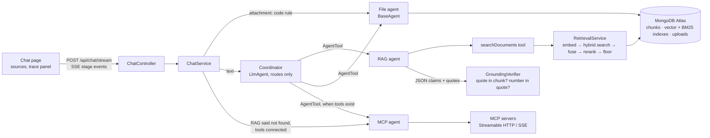

# Agent Framework

A pluggable agent framework on **Java 21, Spring Boot 4 and Google ADK**, with **MongoDB Atlas** as its
only store. One chat page, one coordinator, and agents that are plugins:

- a **RAG agent** that answers from 10 AWS PDFs with hybrid retrieval, a cross-encoder rerank, citations
  with page numbers, and a deterministic check that every quoted sentence really is in the cited passage;
- a **File agent** that summarizes an uploaded file (single pass, or map-reduce for large files);
- **MCP tools** that a user connects at run time from a settings page (Streamable HTTP and SSE, custom
  auth headers), used when the documents have no answer.

> Status: draft written before the final end-to-end run. Numbers marked **[FINAL RUN]** are placeholders
> to be replaced from `docs/END_TO_END.md` after that run (and the VM rerank latency); every other number
> comes from a run documented in `docs/PROGRESS.md` and is labelled with how it was measured.

## The four scenarios it is built around

| | what a user does | what happens |
| --- | --- | --- |
| **A** | asks a question the PDFs answer | coordinator → RAG agent → answer with `[file, page]` citations; the sources list shows the exact quotes |
| **B** | asks something the PDFs do not contain | "Not found in the reference documents." (never an invented answer); if MCP tools are connected, they are tried next |
| **C** | attaches a file and asks for a summary | a code rule sends it to the File agent (no routing model call); large files are summarized map-reduce, with progress |
| **D** | adds an MCP server and credentials in the UI, then asks about its data | the tool is called, its raw result is shown in the trace, no restart |

## Run it locally

Prerequisites: **Java 21**, **Docker**, a **Gemini API key** (Google AI Studio).

**Windows, one click:** put the key in `.env` (`GOOGLE_API_KEY=...`), then double-click

| file | what it does |
| --- | --- |
| `start-demo.bat` | starts MongoDB, downloads the corpus if missing, starts the demo MCP server and the application, opens the browser |
| `check-demo.bat` | live checks against the running app (routing and MCP; about 25 model calls) |
| `run-tests.bat` | the unit tests (`./mvnw verify`; no key, no network) |
| `stop-demo.bat` | stops the app, the demo MCP server and MongoDB (data is kept) |

The manual steps are below (and are what the `.bat` files do).

```bash
git clone <repository URL> agent-framework && cd agent-framework

cp .env.example .env                     # then put your key in GOOGLE_API_KEY
docker compose up -d                     # MongoDB Atlas local (mongod + search), port 27017
bash scripts/fetch-corpus.sh             # the 10 AWS PDFs into ./corpus, sha256-verified (about 40 MB)

# first start: downloads the rerank model (91 MB, sha256-verified) and ingests the corpus (a few minutes)
AGENTFW_INGESTION_ON_STARTUP=true ./mvnw spring-boot:run
```

Open <http://localhost:8080>. Set `AGENTFW_DEMO_PASSWORD` in `.env` to put the app behind a password
(leave it empty on a laptop). Later starts can omit `AGENTFW_INGESTION_ON_STARTUP`; the ingestion is
idempotent and skips unchanged files without an API call.

Tests (no key, no network; MongoDB tests skip if the container is not running):

```bash
./mvnw verify
```

Try each scenario (see `docs/DEMO_MCP.md` for D):

| try | where |
| --- | --- |
| *What is the AWS Well-Architected Tool?* | A |
| *Who won the 2018 FIFA World Cup?* | B |
| attach `scripts/sample-notes.txt` and press Send | C |
| start the demo MCP server, add it under **MCP settings**, ask *Where is order ORD-1001?* | D |

## Architecture



**One request.** `ChatService` creates the turn (request id, session state) and runs the coordinator, a
small model call that only chooses an agent. Agents are `AgentPlugin` beans handed to the coordinator as
ADK `AgentTool`s; adding an agent is one new class, nothing in `core/` changes. What the user sees is
decided in code, never from the coordinator's prose:

- **RAG answers** are read from the retrieval ledger and the agent's JSON contract (a claim = statement +
  chunk ref + verbatim quote). `GroundingVerifier` replaces the whole answer with "Not found" if any quote
  is not in the cited chunk, a number in a claim is not in its quote, or a ref was never retrieved. File and
  page in the citation come from the ledger, not from the model.
- **File summaries** come from a ledger the file agent writes; they are labelled "not quote-checked".
- **MCP answers** come from per-call records (server, tool, arguments, raw result, error); a failed call is
  a tool error with the tool's own message, no matter what the model wrote.
- **No tool called** means the fixed sentence, so the model can never answer from its own knowledge.

**Retrieval funnel:** query embedding (`gemini-embedding-2`, 768 d) → `$vectorSearch` (400 candidates,
20) and BM25 `$search` (20) fused by `$rankFusion` (RRF) → top 20 → cross-encoder rerank of the first 12
(`ms-marco-MiniLM-L6-v2`, ONNX, on the CPU) → top 5 to the model → a low floor (-6.5) removes clear junk.

### Code map

| package | what |
| --- | --- |
| `core` | `AgentPlugin`, `AgentRegistry`, `CoordinatorFactory`, `ChatService` (turn orchestration, answer paths), `TextGenerator` |
| `agents/rag` | RAG plugin, search tool, `RetrievalLedger`, `GroundingVerifier`, malformed-JSON repair |
| `agents/file` | file agent (custom `BaseAgent`), summary ledger |
| `agents/mcp` | MCP agent plugin |
| `retrieval` | hybrid search (3 fusion strategies), cross-encoder (DJL + ONNX Runtime), grounding gate, trace |
| `ingestion` | PDF loader, chunker, embeddings, idempotent ingestion job, "add to knowledge base" |
| `files` | Tika extraction, uploads (TTL), map-reduce summarizer |
| `mcp` | registry (in memory), pre-flight probe, SSRF guard, call ledger |
| `api`, `auth` | controllers, error mapping, SSE, demo login |
| `eval` | calibration and end-to-end runners and reports |

## Design decisions

| decision | why | evidence |
| --- | --- | --- |
| **MongoDB is the only store** (vectors, BM25, chunks, uploads) | one system to run, back up and explain; hybrid search with native `$rankFusion`/`$scoreFusion` | Day 1 spike, `docs/PROGRESS.md` |
| **Hybrid retrieval + cross-encoder rerank**, depth 12, fused with `$rankFusion` | BM25 catches exact terms, vectors catch paraphrase, the cross-encoder fixes the order; reciprocal rank fusion needs no score scales | depth 12 kept the answer page in the final 5 for all 32 questions that depth 20 did (`docs/CALIBRATION.md`); `$scoreFusion` was not better (`docs/FUSION.md`) |
| **A low retrieval floor; the answering step decides** | cross-encoder scores of answerable and unanswerable questions overlap (in-corpus lowest -6.38, out-of-corpus highest 3.17), so no single threshold separates them | `docs/CALIBRATION.md` §1 |
| **Claims must carry verbatim quotes, checked in code** | a model can write a fluent answer from memory; a quote that must exist in the retrieved text cannot be faked, and the check costs no model call | adversarial questions: `docs/e2e/findings.md` §7 |
| **Strict numeric rule** (a number in a claim must be in its quote) | closes the most dangerous gap: a real but unrelated quote next to a figure from memory | the live catch of `256 KB` for SQS |
| **Provenance, not entailment** | the verifier proves where text came from, not that it means what the claim says; stated, not hidden | limitations below |
| **One retry, only for malformed JSON** | the model's most common failure is a syntax slip with correct content; the retry output goes through the same verifier | `docs/PROGRESS.md`, Day 5 step 1 |
| **Attachment goes to the File agent by code** | an attachment is unambiguous; skipping the router saves a model call | step 4 |
| **File agent is a custom `BaseAgent`, not an `LlmAgent` with a tool** | measured: the `LlmAgent` shape added about 4 s of agent overhead (two extra model calls) for the same work | Day 5 step 0 spike |
| **Map-reduce summarization with a neutral map prompt**, bounded parallelism, whole-summary failure | the user's format instruction applies only in the last step; a part is never silently dropped | Day 5 steps 3, 9 |
| **Search cap and early stop enforced in code** | rewriting a query rarely rescued a question and cost about 4 s per extra search | same-hour before/after: median 12.7 s → 9.1 s (Day 4 latency step) |
| **Follow-ups are restated by the coordinator itself** | a separate rewrite call cost 2.5 to 4.5 s per turn; the coordinator already sees the history | live routing check 10 of 10 |
| **"RAG not found → MCP" is orchestrated in `ChatService`** | a RAG answer ends the coordinator's turn (`finalAnswer`), so the model cannot chain a second tool | Day 6 step 2 |
| **MCP configuration in memory only, masked, never logged** | no credential store means no credential-store risk in a demo; stated in the UI | Day 6 steps 1, 5 |
| **SSRF guard on MCP URLs** | the app fetches user-supplied URLs from inside its network; the cloud metadata address must not be reachable | `McpUrlGuardTest` |
| **Stage events over SSE; the answer is not streamed token by token** | the median turn is about 9 s, a silent 9 s looks broken; but an unverified answer must not be shown | Day 5 step 6 |

## Evaluation

All questions are in `src/main/resources/eval/` (48 calibration questions: 32 in the documents, 16 not;
plus 4 adversarial ones). Reports are generated; the hand-written findings sit at the top of each.

**Retrieval** (`docs/CALIBRATION.md`, rerank depth 12; strict pages fixed before the first run, widened
pages added afterwards with a reason each):

| | strict | widened |
| --- | ---: | ---: |
| answer page in the fused top 20 (of 32) | 29 | 31 |
| answer page in the final top 5 (of 32) | 26 | 31 |
| paraphrased questions in the final top 5 (of 2) | 0 | 2 |

**End to end** (real model, 48 questions, `docs/END_TO_END.md`):

| | in-corpus correct (strict pages) | false answers | false "not found" | out-of-corpus answered (of 16) | median / p90 latency |
| --- | ---: | ---: | ---: | ---: | ---: |
| measured during development (`lat-r3-final`, single run) | 28 of 32 (25) | 2 | 2 | 0 | 9.1 s / 13.4 s |
| **final run** | **[FINAL RUN]** | **[FINAL RUN]** | **[FINAL RUN]** | **[FINAL RUN]** | **[FINAL RUN]** |

The two "false answers" of the development runs were read quote by quote and were correct answers that
cited an equivalent page in another document; see `docs/e2e/findings.md` §2. Run to run the number of
false "not found" varied between 2 and 5 on the same configuration (model non-determinism), so single-run
differences of that size are noise.

**Adversarial questions** (a well-known AWS number, absent from the PDFs, phrased to invite an answer
from memory): with the production prompt the model refused itself in 12 of 12 trials (the verifier had
nothing to catch); with a deliberately permissive prompt it answered once in 12 and **the verifier caught
it**; no wrong answer was shown (`docs/e2e/findings.md` §7). **[FINAL RUN]**: repeat on the final build.

**Fusion strategy: `$rankFusion` vs `$scoreFusion`** (`docs/FUSION.md`; same 48 questions, same
embeddings and reranker, retrieval only, no chat-model calls; `$scoreFusion` with sigmoid normalisation and
equal weights, untuned):

| answer page of the 32 in-corpus questions | `$rankFusion` (strict / widened) | `$scoreFusion` (strict / widened) |
| --- | ---: | ---: |
| in the fused top 20 | 29 / 31 | 28 / 29 |
| in the final top 5 sent to the model (rerank 12) | 26 / 31 | 25 / 29 |

`$rankFusion` is equal or better on every measure; the largest gap is one question (strict) or two
(widened) of 32, so this shows that `$scoreFusion` is not better here, not that it is worse in general.
`$scoreFusion` lost "What is the AWS Well-Architected Tool?" (answer page not in its fused top 20) and
gained "What is the principle of least privilege?" at depth 20 only. The widened pages were chosen after
reading `$rankFusion` results, so the strict columns are the fair ones. Decision: keep `RANK`.

**Large files** (Tika extraction + map-reduce, `scripts/live-file-summary-check.py`, single runs): 40 pages
19 s, 124 pages 26 s, 240 pages 65 s, 274 pages 70 s, 1,003 pages 247 s. About 3 s plus 10 s per 100,000
characters.

**Rerank latency on the deployment VM:** **[FINAL RUN]** (laptop, 6 cores: about 0.7 s per search).

## Limitations

- **Verification is provenance, not entailment.** A real quote next to a claim it does not support, in
  words without numbers, would pass. The numeric rule closes the worst case, not every case.
- **Summaries and MCP answers are not quote-verified.** They are labelled; the MCP raw result is shown.
- **Small evaluation set.** 48 questions, one run per configuration; the floor (-6.5) was derived from the
  same questions it is checked on (margin 0.12 logits to the lowest in-corpus score). Paraphrased questions
  are 2 of 32 and were not answered correctly in any development run.
- **Scanned PDFs are not supported** (no OCR): rejected with a clear message.
- **Summaries of very large files are slow** (4 minutes for a 1,003-page PDF) and run inside the request.
  The default limit is 1,000,000 characters.
- **MCP:** configuration is lost on restart; stdio servers are not supported; the SSRF guard checks the
  address at save and connect time but cannot prevent DNS rebinding between its check and the SDK's connect.
- **One shared password**, one role, no per-user data separation. Chat history is in memory (per browser tab).
- **One VM, no high availability**; the demo is single-tenant.
- Language: documents and prompts are English; other languages were not tested.

## Production next steps

1. **MCP configuration persistence with encryption** (envelope encryption, key from a secrets manager),
   per-user ownership, and an egress allow-list at the network level instead of address checks.
2. **Asynchronous jobs** for large summaries and ingestion (a job queue with status polling), so the
   request does not hold a connection for minutes and work survives a restart.
3. **Larger summaries**: hierarchical map-reduce with a cache of part summaries; investigate the
   concurrency ceiling observed at 4 parallel calls.
4. **Real identity** (OIDC) and per-user sessions instead of one password; audit log of tool calls.
5. **Evaluation as a gate**: run the question set on every change, track false "not found" and false
   answers per release; grow the set, especially paraphrases.
6. **Observability**: structured traces to a collector (the trace data already exists per turn),
   quota and latency alerts for the model provider, a fallback model.
7. **Scale-out**: move the cross-encoder to its own service (or a GPU), a managed Atlas cluster with a
   dedicated search tier.

## Operations

| | |
| --- | --- |
| Deploy on a VM (Docker Compose, HTTPS), with the ingested data shipped as a dump | `docs/DEPLOY.md`, `scripts/deploy.sh --restore-db`, `scripts/dump-db.sh`, `docker-compose.prod.yml` |
| Smoke test of a running deployment (19 checks through its public address) | `scripts/smoke-test.py` |
| Demo MCP server and scenario D | `docs/DEMO_MCP.md` |
| Progress log with every measurement | `docs/PROGRESS.md` |
| Live checks against a running app | `scripts/live-routing-check.py`, `live-kb-check.py`, `live-file-summary-check.py`, `live-mcp-check.py` |

Main settings (all in `src/main/resources/application.yml`, environment names in `.env.example`):

| setting | default | meaning |
| --- | --- | --- |
| `GOOGLE_API_KEY` | - | Gemini key (chat and embeddings); never logged, never returned |
| `AGENTFW_DEMO_PASSWORD` | empty (open) | shared password for the whole app |
| `agentfw.llm.model` | `gemini-3.8-flash` | model of the coordinator and the agents (configurable name) |
| `agentfw.rag.max-searches` | 2 | searches per question, enforced in the search tool |
| `agentfw.retrieval.fusion` | `RANK` | `RANK` (`$rankFusion`), `SCORE` (`$scoreFusion`), `JAVA_RRF` |
| `agentfw.retrieval.rerank-depth` / `final-top-n` | 12 / 5 | passages reranked / sent to the model |
| `agentfw.retrieval.min-rerank-score` | -6.5 | retrieval floor |
| `agentfw.files.max-chars` | 1,000,000 | largest file text to summarize |
| `AGENTFW_MCP_ALLOWED_HOSTS` | empty | hosts exempt from the SSRF guard (demo server) |
| `AGENTFW_INGESTION_ON_STARTUP` | false | ingest `./corpus` at start (idempotent) |

Security properties worth knowing: credentials of MCP servers are masked in UI and API, never logged and
never sent to the model; the demo login has a failure lockout; the deployment serves https with `Secure`
cookies; the model sees tool names and descriptions only; the page renders all model and document text as
text (a test fails if the pages use `innerHTML`).
